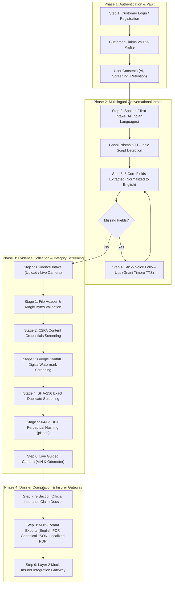

# ClaimSathi AI — Voice-First Motor Insurance Claims Intake Platform

> **IRDAI-Aligned, Multilingual Conversational Motor Insurance Claims Platform for India.**  
> Powered by **Gnani AI Speech APIs** (Prisma STT + Timbre TTS), **Multi-Stage Cryptographic Evidence Screening** (C2PA Content Credentials, Google SynthID, SHA-256, 64-bit DCT pHash), **Supabase PostgreSQL & Cloud Storage**, and **Dynamic Multi-Language 9-Section Dossier Generation**.

> 📄 **[Read our 1-Page Solution Pitch (`SOLUTION_PITCH.md`)](./SOLUTION_PITCH.md)** *(Prepared for The Great Indian Internship Challenge Submission)*  
> 🔒 **[Sprint 1 Security Architecture (`SECURITY_ARCHITECTURE.md`)](./docs/SECURITY_ARCHITECTURE.md)**  
> 🛡️ **[Sprint 1 Security Audit & Remediation (`SPRINT_1_SECURITY_AUDIT.md`)](./docs/SPRINT_1_SECURITY_AUDIT.md)**  
> 🔑 **[View Pre-Seeded Test Customer Accounts (`USER_ACCOUNTS.md`)](./USER_ACCOUNTS.md)**  
> 🖼️ **[View Real Accident Evidence Samples (`test_evidence_samples/`)](./test_evidence_samples/README.md)**

---

## 📌 Table of Contents
1. [End-to-End Product Architecture (7 Phases / 9 Steps)](#1-end-to-end-product-architecture-7-phases--9-steps)
2. [Key Innovations & Technical Highlights](#2-key-innovations--technical-highlights)
3. [Technology Stack](#3-technology-stack)
4. [Step-by-Step E2E User Journey](#4-step-by-step-e2e-user-journey)
5. [Database Architecture & Seeded Customer Accounts](#5-database-architecture--seeded-customer-accounts)
6. [Real Evidence Sample Library (Car & Bike Accidents)](#6-real-evidence-sample-library-car--bike-accidents)
7. [API Endpoints Reference](#7-api-endpoints-reference)
8. [Installation & Quick Start Guide](#8-installation--quick-start-guide)
9. [Automated Verification & Test Suite](#9-automated-verification--test-suite)
10. [Security, Privacy & IRDAI Regulatory Alignment](#10-security-privacy--irdai-regulatory-alignment)
11. [Known MVP Limitations & Honest Engineering Disclosure](#11-known-mvp-limitations--honest-engineering-disclosure)

---

## 1. End-to-End Product Architecture (7 Phases / 9 Steps)

ClaimSathi AI conforms 1:1 to the canonical blueprint specified in `_ClaimSathi AI product flow.pdf`:



---

## 2. Key Innovations & Technical Highlights

### 🎙️ Gnani AI Speech APIs Integration Architecture
ClaimSathi AI integrates Gnani AI's state-of-the-art Vachana platform across two core endpoints:

1. **Gnani Prisma v3.0 Speech-to-Text (STT) (`https://api.vachana.ai/stt/v3`):**
   - **Endpoint & Payload:** Calls the v3 REST API with multipart audio file upload (`audio_file`, 16-bit 16kHz mono PCM WAV) authenticated via `X-API-Key-ID`.
   - **Unified Indian Multilingual Recognition (`indic-auto`):** Supports automatic detection and transcription across 10+ Indian languages (Hindi, Kannada, Telugu, Tamil, Marathi, Bengali, Gujarati, Malayalam, Punjabi, Urdu, and Indian English).
   - **Inverse Text Normalization (`transcribe` mode):** Automatically standardizes spoken vehicle registration numbers, dates, times, and phone numbers into clean alphanumeric digits.
   - **Zero Key Leakage:** Client browsers capture raw microphone audio via Web Audio API and stream directly to the FastAPI backend proxy; the Gnani API key is never exposed to the client.

2. **Gnani Timbre v2.5 Text-to-Speech (TTS) (`https://api.vachana.ai/api/v1/tts/inference`):**
   - **Endpoint & Payload:** Sends structured JSON payloads specifying `text`, `model: "timbre-v2.5"`, `language`, `voice: "Nalini"`, and `audio_config: { encoding: "linear_pcm", container: "wav", sample_rate: 24000 }` via `X-API-Key-ID`.
   - **Sticky Dialect Voice Follow-Ups:** When core incident fields are missing, the system dynamically generates spoken prompts in the claimant's detected mother tongue (e.g., Kannada, Telugu, Hindi, or Tamil) and streams low-latency WAV audio back to HTML5 Audio players in the browser.

### 🗣️ Multilingual Voice Engine with Sticky Language Lock
- **Default Auto-Detect (`indic-auto`)**: The intake engine automatically inspects the customer's very first speech turn across Unicode script ranges and Romanized phonetics (Kannada, Telugu, Hindi, Tamil, Hinglish, Tenglish, Kanglish, Tanglish).
- **Sticky First-Turn Persistence**: Once detected, the conversational agent locks onto that exact dialect for all follow-up questions and synthesizes native voice responses using Gnani Timbre TTS.

### 🛡️ Strict Per-Field Type Validation & Smart Out-of-Order Routing
- **Question Rejection**: Conversational questions (e.g. `"ಸಿ ಎಂ ಎಂ ಅಂದರೆ ಏನು?"` / *"What does CMM mean?"*) are detected and rejected from corrupting insurance claim fields.
- **Smart Out-of-Order Routing**: If a customer provides a vehicle or policy registration number (e.g. `"ಕೆ ಎ ಥರ್ಟೀ ಫೋರ್ ಟು ಟ್ವೆಂಟಿ ತ್ರೀ"` -> `KA-34-2-23`) when asked for an incident location, ClaimSathi routes it to `policy_reference` and re-asks for `incident_location`.
- **100% English Normalization for Insurers**: All 5 extracted core claim fields are converted into standardized English title-case so underwriters and insurance systems receive pristine records regardless of the claimant's language.

### 🔍 5-Stage Cryptographic Evidence & AI Provenance Screening
1. **Magic-Byte Inspection**: Verifies binary headers against spoofed file extensions.
2. **C2PA Content Credentials**: Detects metadata manifests from Adobe Firefly, DALL-E, and Midjourney to flag AI-generated damage.
3. **Google SynthID Detection**: Inspects imperceptible frequency-domain watermarks generated by deep generative models.
4. **SHA-256 Bit-Exact Collision**: Prevents re-submission of the exact same image file across claims.
5. **64-Bit DCT Perceptual Hash (pHash)**: Catches re-compressed, re-saved, or WhatsApp-downscaled fraudulent duplicates across different policies.

### 📄 Multi-Language Dossier Reports & Global UI Localization
- **9-Section Official Dossier**: Generates the complete 9-section insurance dossier containing customer identification, coverage, chronological incident statement, evidence inventory, and regulatory declarations.
- **Download / Print in Preferred Language**: Customers can view and print their report in **English, ಕನ್ನಡ, తెలుగు, हिन्दी, or தமிழ்**, while preserving an **Official English PDF** for underwriters.
- **Global App UI Switcher & Settings Modal**: Instant UI language switcher across all headers, buttons, forms, and profile metadata.

---

## 3. Technology Stack

- **Frontend**:
  - React 18, TypeScript, Vite, Tailwind CSS, Lucide Icons.
  - HTML5 Web Audio API (16-bit 16kHz PCM WAV recorder).
  - WebRTC Guided Live Camera Capture.
  - Custom i18n localization engine supporting English, Kannada, Telugu, Hindi, and Tamil.
- **Backend**:
  - Python 3.11+, FastAPI (Async), Pydantic v2.
  - `httpx` for high-performance external API communication.
  - Pillow & NumPy for 64-bit Discrete Cosine Transform (DCT) perceptual hashing.
  - PyPDF2 / WeasyPrint report generators.
- **Database & Cloud Storage**:
  - **Supabase Cloud PostgreSQL** (`aws-0-ap-southeast-1.pooler.supabase.com:5432/postgres`) with automatic fallback to local async SQLite (`aiosqlite`).
  - **Supabase Storage** (`claimsathi-evidence` bucket) with local file system mirroring.
- **Voice Providers**:
  - **Gnani Prisma v2.5 / v3.0 STT** for speech-to-text.
  - **Gnani Timbre v2.5 TTS** for natural Indian voice synthesis.

---

## 4. Step-by-Step E2E User Journey

```
┌──────────────────────────────────────────────────────────────────────────────────┐
│                               ClaimSathi AI Flow                                 │
└──────────────────────────────────────────────────────────────────────────────────┘

 [Step 1: Sign In]
   │
   ├─► Choose Demo Account (Rahul, Sai, Ananya, Vikram) or Register
   └─► Accepts IRDAI Privacy & AI Screening Consents
   ▼
 [Customer Claims Vault]
   │
   ├─► View Existing Claims & Dossier Statuses
   └─► Click "Start New Claim Intake"
   ▼
 [Step 2–4: Multilingual Voice Intake]
   │
   ├─► Speak in Kannada, Telugu, Hindi, Tamil, or English
   ├─► AI detects language, extracts 5 fields, normalizes to English
   └─► Voice Agent asks targeted follow-ups in claimant's language for missing fields
   ▼
 [Step 5–6: Evidence Screening & Live Camera]
   │
   ├─► Upload photos (or use test samples in test_evidence_samples/)
   ├─► Automatic 5-stage screening (C2PA, SynthID, SHA-256, pHash)
   └─► Live Camera guided verification (Odometer & VIN capture)
   ▼
 [Step 7–9: 9-Section Dossier & Insurer Gateway]
   │
   ├─► Review 9-Section Dossier Summary & Cryptographic Audit Trail
   ├─► Download Report in Preferred Language (English, ಕನ್ನಡ, తెలుగు, हिन्दी, தமிழ்)
   ├─► Download Official English PDF & Canonical JSON
   └─► Submit to Mock Insurer Integration Gateway (Returns ACK reference)
```

---

## 5. Database Architecture & Seeded Customer Accounts

The database maintains 4 pre-seeded real accounts with linked policies, vehicle registrations, and existing vault dossiers:

| Customer Name | Customer ID | Email / Login ID | Password | City & Vehicle | Seeded Claim ID |
| :--- | :--- | :--- | :--- | :--- | :--- |
| **Rahul Sharma** | `USR-100001` | `rahul.sharma@claimsathi.in` | `Rahul@2026` | Bengaluru &bull; KA-01-MJ-4412 (Car) | `CS-2026-000085` |
| **Sai Shankar Reddy** | `USR-100002` | `saishankar.reddy@claimsathi.in` | `Shankar@2026` | Hyderabad &bull; TS-09-EA-9912 (Car) | `CS-2026-000092` |
| **Ananya Lakshmi Iyer**| `USR-100003` | `ananya.iyer@claimsathi.in` | `Ananya@2026` | Chennai &bull; TN-07-BW-2041 (Bike) | `CS-2026-000104` |
| **Vikramaditya Deshmukh**| `USR-100004` | `vikram.deshmukh@claimsathi.in` | `Vikram@2026` | Pune &bull; MH-12-RS-8833 (SUV) | `CS-2026-000118` |

> *All accounts support one-click login on the web interface, or 6-digit OTP verification (`123456`). See [`USER_ACCOUNTS.md`](./USER_ACCOUNTS.md) for full records.*

---

## 6. Real Evidence Sample Library (Car & Bike Accidents)

Real accident photos and cryptographic fraud test cases are available in [`test_evidence_samples/`](./test_evidence_samples/):

- **Real Car Accidents** (`test_evidence_samples/real_car_accidents/`):
  - Front bumper collisions, headlight cracks, side panel denting, rear tailgate crumples.
- **Real Bike Accidents** (`test_evidence_samples/real_bike_accidents/`):
  - Fuel tank denting, handlebar bending, exhaust scrape, front mudguard fractures.
- **Cryptographic Test Variants**:
  - `TEST5_exact_duplicate.jpg` — Triggers **Stage 4: Exact SHA-256 Collision Warning**.
  - `TEST6_resized_whatsapp_duplicate.jpg` — Triggers **Stage 5: 64-Bit DCT pHash Duplicate Warning**.
  - `TEST7A_c2pa_ai_edited.jpg` — Triggers **Stage 2: C2PA Synthetic Content Alert**.
  - `TEST7B_synthid_watermarked.jpg` — Triggers **Stage 3: Google SynthID Deepfake Alert**.

---

## 7. API Endpoints Reference

### Authentication (`/api/auth`)
- `POST /api/auth/login` — Sign in via identifier + password or OTP.
- `POST /api/auth/register` — Register a new customer and capture IRDAI consents.
- `POST /api/auth/request-otp` — Request 6-digit verification OTP.
- `GET /api/auth/profile/{customer_id}` — Retrieve customer profile, vehicles, and active policies.

### Conversational Voice & Intake (`/api/voice` & `/api/claims`)
- `POST /api/voice/transcribe` — Process audio speech through Gnani Prisma STT with language auto-detection.
- `POST /api/voice/speak` — Synthesize native Indian speech responses via Gnani Timbre TTS.
- `POST /api/claims/extract-fields` — Extract 5 core claim fields and normalize to English.
- `POST /api/claims/validate-field-answer` — Validates answer against field type, rejects questions, and routes misplaced answers.

### Evidence & Integrity Screening (`/api/claims`)
- `POST /api/claims/{claim_id}/evidence/upload` — Ingest evidence image/video through the 5-stage screening pipeline.
- `POST /api/claims/{claim_id}/evidence/live-capture` — Ingest live WebRTC camera capture with tamper-proof timestamp.
- `GET /api/claims/{claim_id}/evidence` — List screened evidence assets with C2PA, SynthID, and pHash scores.

### Dossier & Insurer Gateway (`/api/claims`)
- `POST /api/claims/{claim_id}/generate-dossier` — Compile the 9-section official claim dossier.
- `GET /api/claims/{claim_id}/report/pdf` — Download official English binary PDF for insurers.
- `GET /api/claims/{claim_id}/report/localized?lang={kn|te|hi|ta|en}` — Download/print dossier in claimant's language.
- `GET /api/claims/{claim_id}/report/canonical-json` — Export Layer 1 canonical JSON.
- `POST /api/claims/{claim_id}/submit-insurer` — Submit claim package to Layer 2 Mock Insurer Gateway.

---

## 8. Installation & Quick Start Guide

### 1. Clone & Set Up Backend

```powershell
cd "d:\ClaimSathi AI\backend"
copy .env.example .env    # Configure Gnani API credentials & Supabase URL
python -m uvicorn app.main:app --reload --host 127.0.0.1 --port 8080
```
- Interactive OpenAPI Docs: `http://127.0.0.1:8080/docs`
- Health Status: `http://127.0.0.1:8080/api/health`

### 2. Set Up Frontend

```powershell
cd "d:\ClaimSathi AI\frontend"
npm install
npm run dev
```
- Web Application: `http://localhost:5173`

---

## 9. Automated Verification & Test Suite

ClaimSathi AI includes **41 automated pytest suites** covering the entire 7-phase product lifecycle and Sprint 1 security & data isolation matrix:

```powershell
cd "d:\ClaimSathi AI\backend"
python -m pytest backend/tests -v
```

### Verified Test Matrix (41 Passed):
- `test_acceptance.py`: End-to-end Hinglish and Telugu voice conversational acceptance workflows.
- `test_claims.py`: Health check, mock transcription, claim creation, validation, retrieval, and listing.
- `test_master_flow.py`: Registration, customer vault summary, multilingual extraction, sticky follow-ups, duplicate screening (SHA-256 and 64-bit DCT pHash), C2PA / SynthID synthetic provenance rules, guided live capture, 9-section PDF rendering, canonical schema JSON export, and mock insurer gateway submission.
- `test_security_sprint1.py` (16 New Security Suites):
  - Missing, invalid, expired, and tampered JWT rejection (HTTP 401).
  - Production startup rejection on missing/insecure JWT secrets.
  - OTP single-use consumption and universal code (`123456`) production blocking.
  - Multi-tenant customer claim isolation: Customer B receives HTTP 403 on Customer A's claim across read, update, capture, upload, list, download, report, and insurer submission.
  - Zero-overlap claim isolation in customer dashboard lists.
  - Tamper-proof customer identity (query string and body `customer_id` spoofing ignored).
  - Evidence upload MIME / magic byte signature validation (fake `.exe` and fake `.png` rejected with HTTP 400).
  - Path traversal attack prevention (`../` sequences safely blocked).
  - Structured audit trail verification with zero credential leaks.
- `test_voice.py`: Gnani Prisma STT (v2.5, v3.0), audio duration limits, unsupported audio formats, credit exhaustion handling, Timbre TTS synthesis, and API key protection.

---

## 10. Security, Privacy & IRDAI Regulatory Alignment

- **Zero-Trust Customer Data Isolation**: User identity is derived strictly from verified JWT signatures (`sub` claim). Claim ownership is validated on every single operation. Cross-customer access attempts return **HTTP 403 Forbidden** and trigger an audit alert.
- **PostgreSQL Row-Level Security (RLS)**: 17 active RLS policies with `FORCE ROW LEVEL SECURITY` guarantee database-enforced multi-tenant isolation even in direct query contexts.
- **Append-Only Security Audit Trail**: Access, modification, and authorization events are immutably logged with `resource_type`, `resource_id`, and `outcome`. No `UPDATE` or `DELETE` operations are permitted on audit records.
- **Zero Credential Exposure**: Gnani API keys, Supabase credentials, and database connection strings are encapsulated in the backend and never exposed to the frontend or git.
- **Explicit Customer Consents**: Registration enforces 3 mandatory checkboxes aligning with the Digital Personal Data Protection (DPDP) Act:
  1. AI voice/text processing for claim intake.
  2. Cryptographic screening (C2PA, SynthID, SHA-256, pHash).
  3. Claims Vault retention and privacy policies.
- **Tamper-Evident Dossiers**: All 9 sections embed cryptographic asset hashes and timestamped audit logs for insurer non-repudiation.
- **Safe Sandboxing**: Insurer gateway submissions connect to isolated mock endpoints preventing unintended external filings during evaluation.

---

## 11. Known MVP Limitations & Honest Engineering Disclosure

To maintain complete engineering transparency and zero overclaiming, we explicitly document the two core limitations of this MVP:

### 1. Deepfake & AI-Generated Media Detection Limitations
- **What we detect:** Our 5-stage evidence screening engine inspects files for **C2PA Content Credentials** (`c2pa` JUMBF manifests), **Google SynthID** watermark markers, **SHA-256 exact duplicates**, and **64-bit DCT Perceptual Hash (pHash)** near-duplicates (catches WhatsApp-compressed or resized duplicates across claims).
- **What is a limitation:** If a sophisticated deepfake or AI-manipulated image is generated by an unwatermarked open-source model or has had its provenance metadata stripped (e.g., via screenshots or re-encoding), **software provenance checks alone cannot guarantee 100% deepfake detection**.
- **How we handle it honestly:** Standard camera photos without C2PA/SynthID metadata are **never** falsely labeled as "100% Authentic." Instead, they are transparently labeled **`Inconclusive — Manual Surveyor Review Recommended`**, and we pair uploads with **Server-Tokenized Live WebRTC Camera Capture** to provide stronger real-time capture assurance while keeping human surveyor review in the loop.

### 2. No Real Commercial Insurance Company Tie-Up Yet (Simulated Insurer Gateway)
- **Current status:** ClaimSathi AI does **not** currently have live commercial API tie-ups or production integrations with real insurance carriers (such as Bajaj Allianz, ICICI Lombard, or Royal Sundaram).
- **How we handle it honestly:** We implement a **Two-Layer Interoperability Architecture**:
  - **Layer 1 (Production-Ready Output):** Generates a standardized **ClaimSathi Canonical Schema JSON** and a **9-Section Official Claim Dossier PDF** that a policyholder can manually submit to any insurer or surveyor today.
  - **Layer 2 (Simulated Insurer Gateway):** Routes submissions through a **Mock Insurer Integration Gateway (`DEMO_INSURER_A`, `BHARAT_GENERAL_MOCK`)** that demonstrates schema mapping and acknowledgement workflows, explicitly tagged across both the UI and API responses with:  
    `⚠️ Demo only — not a real insurer submission`.

