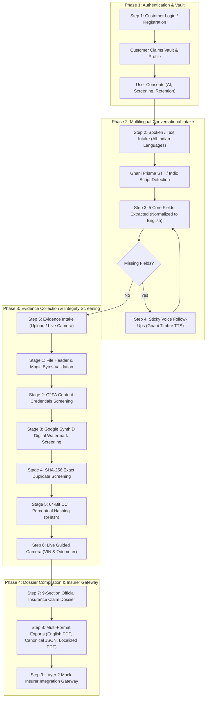

# ClaimSathi AI — Voice-First Motor Insurance Claims Intake Platform

> **IRDAI-Aligned, Multilingual Conversational Motor Insurance Claims Platform for India.**  
> Powered by **Gnani AI Speech APIs** (Prisma STT + Timbre TTS), **Multi-Stage Cryptographic Evidence Screening** (C2PA Content Credentials, Google SynthID, SHA-256, 64-bit DCT pHash), **Supabase PostgreSQL & Cloud Storage**, and **Dynamic Multi-Language 9-Section Dossier Generation**.

---

## 📌 Table of Contents
1. [End-to-End Product Architecture (7 Phases / 9 Steps)](#1-end-to-end-product-architecture-7-phases--9-steps)
2. [Key Innovations & Technical Highlights](#2-key-innovations--technical-highlights)
3. [Technology Stack](#3-technology-stack)
4. [Step-by-Step E2E User Journey](#4-step-by-step-e2e-user-journey)
5. [Database Architecture & Seeded Customer Accounts](#5-database-architecture--seeded-customer-accounts)
6. [Real Evidence Sample Library (Car & Bike Accidents)](#6-real-evidence-sample-library-car--bike-accidents)
7. [API Endpoints Reference](#7-api-endpoints-reference)
8. [Installation & Quick Start Guide](#8-installation--quick-start-guide)
9. [Automated Verification & Test Suite](#9-automated-verification--test-suite)
10. [Security, Privacy & IRDAI Regulatory Alignment](#10-security-privacy--irdai-regulatory-alignment)

---

## 1. End-to-End Product Architecture (7 Phases / 9 Steps)

ClaimSathi AI conforms 1:1 to the canonical blueprint specified in `_ClaimSathi AI product flow.pdf`:



---

## 2. Key Innovations & Technical Highlights

### 🗣️ Multilingual Voice Engine with Sticky Language Lock
- **Default Auto-Detect (`indic-auto`)**: The intake engine automatically inspects the customer's very first speech turn across Unicode script ranges and Romanized phonetics (Kannada, Telugu, Hindi, Tamil, Hinglish, Tenglish, Kanglish, Tanglish).
- **Sticky First-Turn Persistence**: Once detected, the conversational agent locks onto that exact dialect for all follow-up questions and synthesizes native voice responses using Gnani Timbre TTS.

### 🛡️ Strict Per-Field Type Validation & Smart Out-of-Order Routing
- **Question Rejection**: Conversational questions (e.g. `"ಸಿ ಎಂ ಎಂ ಅಂದರೆ ಏನು?"` / *"What does CMM mean?"*) are detected and rejected from corrupting insurance claim fields.
- **Smart Out-of-Order Routing**: If a customer provides a vehicle or policy registration number (e.g. `"ಕೆ ಎ ಥರ್ಟೀ ಫೋರ್ ಟು ಟ್ವೆಂಟಿ ತ್ರೀ"` -> `KA-34-2-23`) when asked for an incident location, ClaimSathi routes it to `policy_reference` and re-asks for `incident_location`.
- **100% English Normalization for Insurers**: All 5 extracted core claim fields are converted into standardized English title-case so underwriters and insurance systems receive pristine records regardless of the claimant's language.

### 🔍 5-Stage Cryptographic Evidence & AI Provenance Screening
1. **Magic-Byte Inspection**: Verifies binary headers against spoofed file extensions.
2. **C2PA Content Credentials**: Detects metadata manifests from Adobe Firefly, DALL-E, and Midjourney to flag AI-generated damage.
3. **Google SynthID Detection**: Inspects imperceptible frequency-domain watermarks generated by deep generative models.
4. **SHA-256 Bit-Exact Collision**: Prevents re-submission of the exact same image file across claims.
5. **64-Bit DCT Perceptual Hash (pHash)**: Catches re-compressed, re-saved, or WhatsApp-downscaled fraudulent duplicates across different policies.

### 📄 Multi-Language Dossier Reports & Global UI Localization
- **9-Section Official Dossier**: Generates the complete 9-section insurance dossier containing customer identification, coverage, chronological incident statement, evidence inventory, and regulatory declarations.
- **Download / Print in Preferred Language**: Customers can view and print their report in **English, ಕನ್ನಡ, తెలుగు, हिन्दी, or தமிழ்**, while preserving an **Official English PDF** for underwriters.
- **Global App UI Switcher & Settings Modal**: Instant UI language switcher across all headers, buttons, forms, and profile metadata.

---

## 3. Technology Stack

- **Frontend**:
  - React 18, TypeScript, Vite, Tailwind CSS, Lucide Icons.
  - HTML5 Web Audio API (16-bit 16kHz PCM WAV recorder).
  - WebRTC Guided Live Camera Capture.
  - Custom i18n localization engine supporting English, Kannada, Telugu, Hindi, and Tamil.
- **Backend**:
  - Python 3.11+, FastAPI (Async), Pydantic v2.
  - `httpx` for high-performance external API communication.
  - Pillow & NumPy for 64-bit Discrete Cosine Transform (DCT) perceptual hashing.
  - PyPDF2 / WeasyPrint report generators.
- **Database & Cloud Storage**:
  - **Supabase Cloud PostgreSQL** (`aws-0-ap-southeast-1.pooler.supabase.com:5432/postgres`) with automatic fallback to local async SQLite (`aiosqlite`).
  - **Supabase Storage** (`claimsathi-evidence` bucket) with local file system mirroring.
- **Voice Providers**:
  - **Gnani Prisma v2.5 / v3.0 STT** for speech-to-text.
  - **Gnani Timbre v2.5 TTS** for natural Indian voice synthesis.

---

## 4. Step-by-Step E2E User Journey

```
┌──────────────────────────────────────────────────────────────────────────────────┐
│                               ClaimSathi AI Flow                                 │
└──────────────────────────────────────────────────────────────────────────────────┘

 [Step 1: Sign In]
   │
   ├─► Choose Demo Account (Rahul, Sai, Ananya, Vikram) or Register
   └─► Accepts IRDAI Privacy & AI Screening Consents
   ▼
 [Customer Claims Vault]
   │
   ├─► View Existing Claims & Dossier Statuses
   └─► Click "Start New Claim Intake"
   ▼
 [Step 2–4: Multilingual Voice Intake]
   │
   ├─► Speak in Kannada, Telugu, Hindi, Tamil, or English
   ├─► AI detects language, extracts 5 fields, normalizes to English
   └─► Voice Agent asks targeted follow-ups in claimant's language for missing fields
   ▼
 [Step 5–6: Evidence Screening & Live Camera]
   │
   ├─► Upload photos (or use test samples in test_evidence_samples/)
   ├─► Automatic 5-stage screening (C2PA, SynthID, SHA-256, pHash)
   └─► Live Camera guided verification (Odometer & VIN capture)
   ▼
 [Step 7–9: 9-Section Dossier & Insurer Gateway]
   │
   ├─► Review 9-Section Dossier Summary & Cryptographic Audit Trail
   ├─► Download Report in Preferred Language (English, ಕನ್ನಡ, తెలుగు, हिन्दी, தமிழ்)
   ├─► Download Official English PDF & Canonical JSON
   └─► Submit to Mock Insurer Integration Gateway (Returns ACK reference)
```

---

## 5. Database Architecture & Seeded Customer Accounts

The database maintains 4 pre-seeded real accounts with linked policies, vehicle registrations, and existing vault dossiers:

| Customer Name | Customer ID | Email / Login ID | Password | City & Vehicle | Seeded Claim ID |
| :--- | :--- | :--- | :--- | :--- | :--- |
| **Rahul Sharma** | `USR-100001` | `rahul.sharma@claimsathi.in` | `Rahul@2026` | Bengaluru &bull; KA-01-MJ-4412 (Car) | `CS-2026-000085` |
| **Sai Shankar Reddy** | `USR-100002` | `saishankar.reddy@claimsathi.in` | `Shankar@2026` | Hyderabad &bull; TS-09-EA-9912 (Car) | `CS-2026-000092` |
| **Ananya Lakshmi Iyer**| `USR-100003` | `ananya.iyer@claimsathi.in` | `Ananya@2026` | Chennai &bull; TN-07-BW-2041 (Bike) | `CS-2026-000104` |
| **Vikramaditya Deshmukh**| `USR-100004` | `vikram.deshmukh@claimsathi.in` | `Vikram@2026` | Pune &bull; MH-12-RS-8833 (SUV) | `CS-2026-000118` |

> *All accounts support one-click login on the web interface, or 6-digit OTP verification (`123456`). See [`USER_ACCOUNTS.md`](./USER_ACCOUNTS.md) for full records.*

---

## 6. Real Evidence Sample Library (Car & Bike Accidents)

Real accident photos and cryptographic fraud test cases are available in [`test_evidence_samples/`](./test_evidence_samples/):

- **Real Car Accidents** (`test_evidence_samples/real_car_accidents/`):
  - Front bumper collisions, headlight cracks, side panel denting, rear tailgate crumples.
- **Real Bike Accidents** (`test_evidence_samples/real_bike_accidents/`):
  - Fuel tank denting, handlebar bending, exhaust scrape, front mudguard fractures.
- **Cryptographic Test Variants**:
  - `TEST5_exact_duplicate.jpg` — Triggers **Stage 4: Exact SHA-256 Collision Warning**.
  - `TEST6_resized_whatsapp_duplicate.jpg` — Triggers **Stage 5: 64-Bit DCT pHash Duplicate Warning**.
  - `TEST7A_c2pa_ai_edited.jpg` — Triggers **Stage 2: C2PA Synthetic Content Alert**.
  - `TEST7B_synthid_watermarked.jpg` — Triggers **Stage 3: Google SynthID Deepfake Alert**.

---

## 7. API Endpoints Reference

### Authentication (`/api/auth`)
- `POST /api/auth/login` — Sign in via identifier + password or OTP.
- `POST /api/auth/register` — Register a new customer and capture IRDAI consents.
- `POST /api/auth/request-otp` — Request 6-digit verification OTP.
- `GET /api/auth/profile/{customer_id}` — Retrieve customer profile, vehicles, and active policies.

### Conversational Voice & Intake (`/api/voice` & `/api/claims`)
- `POST /api/voice/transcribe` — Process audio speech through Gnani Prisma STT with language auto-detection.
- `POST /api/voice/speak` — Synthesize native Indian speech responses via Gnani Timbre TTS.
- `POST /api/claims/extract-fields` — Extract 5 core claim fields and normalize to English.
- `POST /api/claims/validate-field-answer` — Validates answer against field type, rejects questions, and routes misplaced answers.

### Evidence & Integrity Screening (`/api/claims`)
- `POST /api/claims/{claim_id}/evidence/upload` — Ingest evidence image/video through the 5-stage screening pipeline.
- `POST /api/claims/{claim_id}/evidence/live-capture` — Ingest live WebRTC camera capture with tamper-proof timestamp.
- `GET /api/claims/{claim_id}/evidence` — List screened evidence assets with C2PA, SynthID, and pHash scores.

### Dossier & Insurer Gateway (`/api/claims`)
- `POST /api/claims/{claim_id}/generate-dossier` — Compile the 9-section official claim dossier.
- `GET /api/claims/{claim_id}/report/pdf` — Download official English binary PDF for insurers.
- `GET /api/claims/{claim_id}/report/localized?lang={kn|te|hi|ta|en}` — Download/print dossier in claimant's language.
- `GET /api/claims/{claim_id}/report/canonical-json` — Export Layer 1 canonical JSON.
- `POST /api/claims/{claim_id}/submit-insurer` — Submit claim package to Layer 2 Mock Insurer Gateway.

---

## 8. Installation & Quick Start Guide

### 1. Clone & Set Up Backend

```powershell
cd "d:\ClaimSathi AI\backend"
copy .env.example .env    # Configure Gnani API credentials & Supabase URL
python -m uvicorn app.main:app --reload --host 127.0.0.1 --port 8080
```
- Interactive OpenAPI Docs: `http://127.0.0.1:8080/docs`
- Health Status: `http://127.0.0.1:8080/api/health`

### 2. Set Up Frontend

```powershell
cd "d:\ClaimSathi AI\frontend"
npm install
npm run dev
```
- Web Application: `http://localhost:5173`

---

## 9. Automated Verification & Test Suite

ClaimSathi AI includes 25 automated pytest suites covering the entire 7-phase product lifecycle:

```powershell
cd "d:\ClaimSathi AI\backend"
python -m pytest -v
```

### Verified Test Matrix:
- `test_master_01_customer_registration_login_and_vault`: Authentication, session validation, and vault querying.
- `test_master_02_and_03_conversation_extraction_and_missing_followup`: Multilingual intake, extraction, and sticky follow-up loops.
- `test_master_04_05_06_evidence_integrity_exact_and_resized_duplicates`: Magic bytes, SHA-256 duplicate, and pHash screening.
- `test_master_07_and_08_ai_provenance_c2pa_synthid_and_inconclusive_rules`: C2PA and SynthID synthetic provenance detection.
- `test_master_09_10_11_12_live_capture_dossier_pdf_and_mock_insurer_gateway`: Live camera ingestion, 9-section PDF rendering, canonical JSON export, and mock insurer gateway submission.
- `test_telugu_voice_conversational_acceptance`: End-to-end Telugu voice conversational acceptance.

---

## 10. Security, Privacy & IRDAI Regulatory Alignment

- **Zero Credential Exposure**: Gnani API keys and Supabase connection strings are securely encapsulated in the FastAPI backend and never forwarded to client browsers.
- **Explicit Customer Consents**: Registration enforces 3 mandatory checkboxes aligning with the Digital Personal Data Protection (DPDP) Act:
  1. AI voice/text processing for claim intake.
  2. Cryptographic screening (C2PA, SynthID, SHA-256, pHash).
  3. Claims Vault retention and privacy policies.
- **Tamper-Evident Dossiers**: All 9 sections embed cryptographic asset hashes and timestamped audit logs for insurer non-repudiation.
- **Safe Sandboxing**: Insurer gateway submissions connect to isolated mock endpoints preventing unintended external filings during evaluation.
